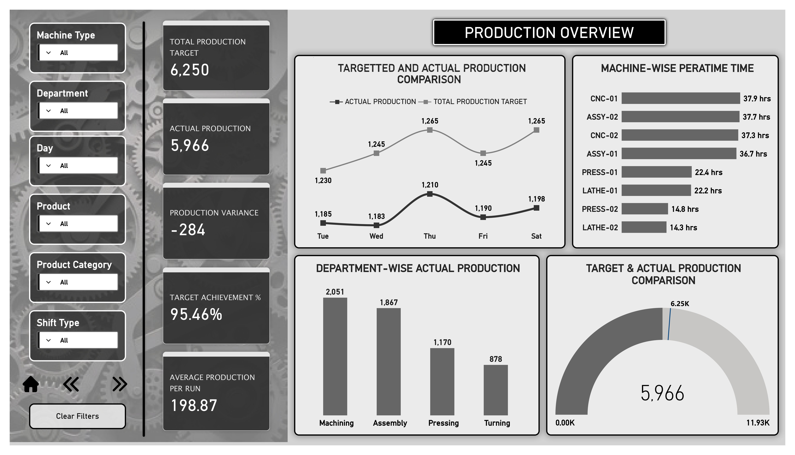
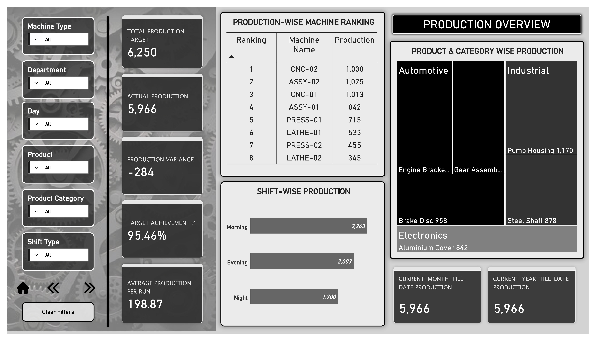
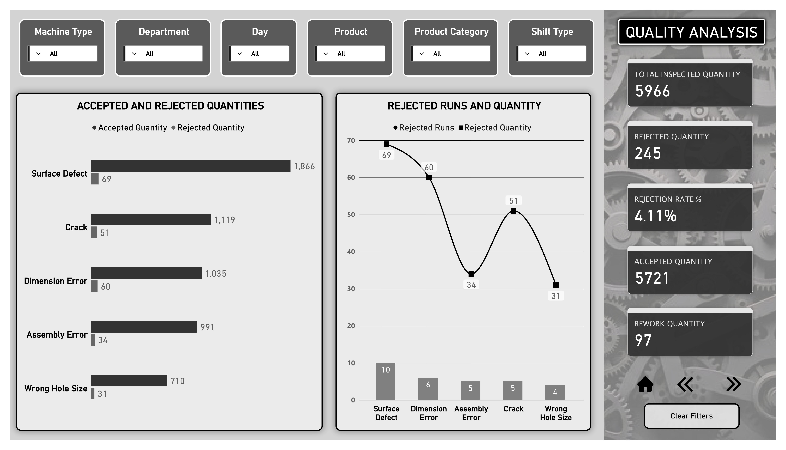
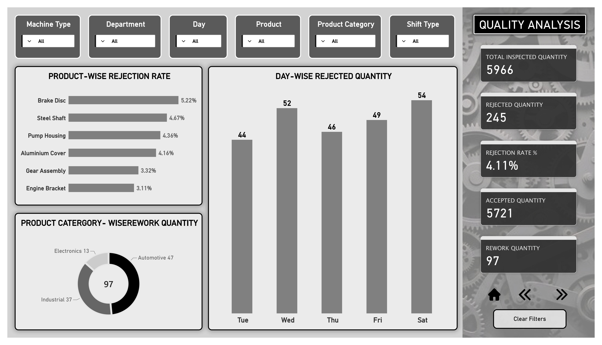
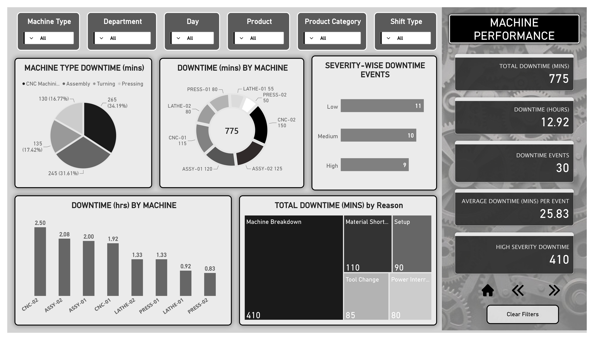
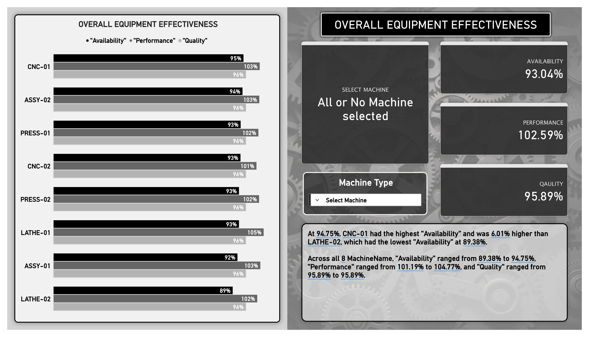

# Manufacturing & Production Analytics Dashboard

**Power BI | Manufacturing Analytics | Business Intelligence**

An interactive Power BI dashboard developed to analyze manufacturing operations through production monitoring, quality inspection, machine performance, and Overall Equipment Effectiveness (OEE).

## Project Overview

The objective of this project was to transform manufacturing data into meaningful insights that help monitor production targets, evaluate product quality, identify machine downtime, and understand overall operational performance.

The dashboard is organized into four analytical areas:

1. Production Overview
2. Quality Analysis
3. Machine Performance
4. Overall Equipment Effectiveness (OEE)

## Dashboard Sections

### 1. Production Overview

Analyzes production output and compares actual performance against planned targets.

**Key Metrics**

| KPI                        | Result |
| -------------------------- | -----: |
| Total Production Target    |  6,250 |
| Actual Production          |  5,966 |
| Production Variance        |    284 |
| Target Achievement         | 95.46% |
| Average Production per Run | 198.87 |

**Analysis Includes**

* Monthly target vs. actual production.
* Department-wise production comparison.
* Machine-wise production ranking.
* Shift-wise production analysis.
* Product and category-wise production.

### 2. Quality Analysis

Evaluates product quality through inspection results, rejection rates, and rework quantities.

**Key Metrics**

| KPI                      | Result |
| ------------------------ | -----: |
| Total Inspected Quantity |  5,966 |
| Accepted Quantity        |  5,721 |
| Rejected Quantity        |    245 |
| Rejection Rate           |  4.11% |
| Rework Quantity          |     97 |

**Analysis Includes**

* Accepted vs. rejected quantities.
* Product-wise rejection rates.
* Defect category analysis.
* Day-wise rejected quantity.
* Product category-wise rework analysis.

### 3. Machine Performance

Focuses on equipment downtime, breakdown patterns, and machine-level performance.

**Key Metrics**

| KPI                        |        Result |
| -------------------------- | ------------: |
| Total Downtime             |   775 Minutes |
| Downtime in Hours          |   12.92 Hours |
| Downtime Events            |            30 |
| Average Downtime per Event | 25.83 Minutes |
| High-Severity Downtime     |   410 Minutes |

**Analysis Includes**

* Machine-wise downtime comparison.
* Downtime reason analysis.
* Downtime severity analysis.
* Machine runtime comparison.
* Machine production performance.

### 4. Overall Equipment Effectiveness (OEE)

Evaluates manufacturing effectiveness through three important indicators.

| OEE Indicator |  Result |
| ------------- | ------: |
| Availability  |  93.04% |
| Performance   | 102.59% |
| Quality       |  95.89% |

## Tools & Technologies

* Microsoft Power BI
* Power Query
* DAX Measures
* Data Modeling
* Data Visualization
* KPI Development
* Interactive Dashboard Design

## Project Workflow

1. Data preparation and loading.
2. Data transformation using Power Query.
3. Data modeling and relationship development.
4. DAX measure creation.
5. KPI development.
6. Dashboard design and visualization.
7. Manufacturing performance analysis.

## Key Learning

This project helped strengthen my practical understanding of Power BI and manufacturing analytics.

It provided an opportunity to explore how production, quality, and machine performance data can be combined to monitor operations, identify performance gaps, and support data-driven management decisions.

## Dashboard Preview

### 1. Production Overview

### 2. Quality Analysis

### 3. Machine Performance

### 4. OEE Analysis

## Project Credits

Completed as part of my practical learning journey with **Bright Computer Education** and **Kamlesh Vaghela**.

---

**Created by: Divyesh Tadvi**

*Learning, building, and improving through hands-on data analytics projects.*
